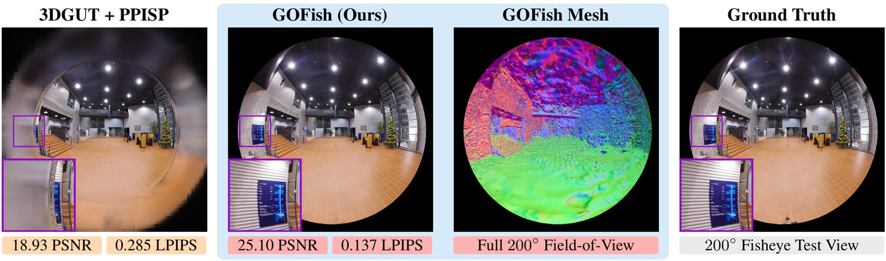

# GOFish: Full Field-of-View Gaussian Splatting and Mesh Extraction

[Allen Tu](https://tuallen.github.io/)<sup>1,2</sup>, [Meher Gitika Karumuri](https://scholar.google.com/citations?user=R14csHAAAAAJ)<sup>1</sup>, [Shifan Zhu](https://shifanzhu.github.io/)<sup>1,3</sup>, [Hailing Wang](https://scholar.google.com/citations?user=oKoYjqUAAAAJ)<sup>1,4</sup>, [Yen-Liang Lin](https://sites.google.com/view/yenlianglin)<sup>1</sup>, [David Held](https://davheld.github.io/)<sup>1,5</sup>, [Matthias Zwicker](https://www.cs.umd.edu/~zwicker/)<sup>2</sup>, [Tom Goldstein](https://www.cs.umd.edu/~tomg/)<sup>2</sup>

<sup>1</sup>Amazon, <sup>2</sup>University of Maryland, College Park, <sup>3</sup>University of Massachusetts Amherst, <sup>4</sup>Northeastern University, <sup>5</sup>Carnegie Mellon University

[Project page](https://3dgofish.github.io) | [Paper](https://arxiv.org/abs/2610.37818) | [Models](https://huggingface.co/datasets/AllenTu/GOFish-scenes)



## Abstract

Robots, autonomous vehicles, and consumer 360° cameras use fisheye lenses for wide fields of view (FoVs).
Simulation-ready digital twins require photorealistic rendering across the full FoV and an aligned collision
mesh. However, prior fisheye Gaussian Splatting methods only rasterize up to 180° and do not produce meshes,
while Gaussian surface reconstruction methods assume pinhole training images. We present GOFish, the first 3D
Gaussian Splatting surface reconstruction method to train directly on fisheye images, rasterize FoVs beyond
180°, and extract an aligned mesh from the same scene. Calibrated densification recovers the surface across
the entire FoV, while Calibrated Mip Filtering and Wide-Angle Appearance Modeling keep pixel blur and lens
falloff out of the scene and mesh. Across the 200° FIORD and 205° FullCircle benchmarks, GOFish improves PSNR
over the best prior method by 2.28 and 1.97 dB, respectively. It also outperforms fisheye rendering baselines
within their own FoVs and achieves the highest mesh F-score on FIORD and the main ScanNet++ set. Together, the
Gaussian scene and mesh form a LiDAR-free, simulation-ready digital twin that renders in real time, ray traces
the full FoV, and provides collision geometry.

## Installation

Requirements: Linux, an NVIDIA GPU of compute capability 7.0 or newer (the paper used an A10G with
24 GB), a CUDA toolkit, Python 3.11 and the PyTorch build for that CUDA version.

```bash
git clone --recursive <repository URL> gofish
cd gofish
pip install torch torchvision --index-url https://download.pytorch.org/whl/cu128  # use the index matching your CUDA toolkit
pip install -e ".[eval]"
pip install --no-build-isolation -r requirements_extra.txt

# The renderer compiles Slang kernels; put the Slang release on PATH
mkdir -p ../slang && curl -L https://github.com/shader-slang/slang/releases/download/v2026.5.2/slang-2026.5.2-linux-x86_64.tar.gz | tar -xz -C ../slang
export PATH="$(realpath ../slang)/bin:$PATH"
```

`requirements-paper.txt` pins the package versions used for the paper. The CUDA extensions compile
on first use, and the evaluators download the LPIPS VGG weights on first use.

Mesh extraction also needs CGAL and the tetra-triangulation extension of GOF:

```bash
sudo apt install cmake libgmp-dev libcgal-dev
git clone https://github.com/autonomousvision/gaussian-opacity-fields ../gaussian-opacity-fields
git -C ../gaussian-opacity-fields checkout 5245b20e5d11acd6d1ff5af4b890dc2bedd99693
cd ../gaussian-opacity-fields/submodules/tetra-triangulation
sed -i 's/_GLIBCXX_USE_CXX11_ABI=0/_GLIBCXX_USE_CXX11_ABI=1/' cmake/FindTorch.cmake   # ABI of current torch wheels
export CPATH=/usr/local/cuda/include   # CUDA headers for the extension's C++ sources
cmake -DCMAKE_PREFIX_PATH="$(python -c 'import torch; print(torch.utils.cmake_prefix_path)')" . && make
pip install -e . && cd -
```

## Data preparation

Prepare one folder per scene:

- **[FIORD](https://parmisian.github.io/fiord360.github.io/)**: download each scene's zip from
  [Zenodo](https://zenodo.org/communities/fiord) and unzip into one root. Commands and outputs use the
  paper's scene labels; the archives unpack to these folders:

  | Scene | Folder | | Scene | Folder |
  |---|---|---|---|---|
  | Kitchen_In | `Kitchen_In` | | Bridge_Out | `outcorridor` |
  | MeetingRoom_In | `meetingroom` | | Corridor_Out | `festia_out_corridor` |
  | Building_In | `parakennus` | | Road_Out | `main_campus` |
  | Hall_In | `sportunifront` | | | |

  Convert each scene's E57 LiDAR scan once with
  `python -m gofish.data.fiord lidar <FIORD>/<folder>/<scan>.e57 <lidar>/<label>.npy`; the benchmark
  script prepares the images. Corridor_Out is evaluated for rendering only, as in the paper.
- **[FullCircle](https://arxiv.org/abs/2603.22572)**: the released scenes,
  `<scene>/{sparse/0, images_4, masks_4}` and `masking/mask_test.png`.
- **[ScanNet++](https://kaldir.vc.in.tum.de/scannetpp/)**:
  `<scene>/dslr/{colmap, resized_images, nerfstudio}` and `<scene>/scans/mesh_aligned_0.05.ply`. For
  the Common region, run the ScanNet++ toolkit's `python -m dslr.undistort dslr/configs/undistort.yml`
  with `data_root` set.
- **[Tanks & Temples](https://www.tanksandtemples.org)**: the training scenes
  as preprocessed by GOF, `<scene>/{sparse/0, images_2}`, and the official evaluation folders for
  geometry.

## Reproducing the paper

Each script trains, renders, meshes and evaluates every paper scene of a dataset, and ends with the
dataset means reported in the paper (`python -m gofish.eval.summary`):

```bash
bash benchmark/fiord.sh      --exact --data /data/FIORD --lidar /data/fiord_lidar/%s.npy
bash benchmark/fullcircle.sh --exact --data /data/FullCircle
bash benchmark/scannetpp.sh  --exact --data /data/scannetpp
bash benchmark/tnt.sh        --exact --data /data/tnt --tnt-eval /data/tnt_eval
```

`--exact` renders the test sets with the exact renderer used for the paper's tables, `--geometry` trains
GOFish + Geometry Objective, and `--help` lists the remaining options. In `--lidar`, `%s` receives the
paper label of each scene. Each scene writes `<out>/<scene>/` with the checkpoints, `heldout/` renders,
`fps.json`, `mesh/mesh.ply` and the `eval_*.json` scores.

## Training, rendering and meshing one scene

```bash
DATA=runs/_data/Kitchen_In
RUN=runs/Kitchen_In
python -m gofish.data.fiord scene /data/FIORD/Kitchen_In "$DATA"

# Train GOFish (add geometry=sof for + Geometry Objective)
python train.py --config-name apps/fiord path="$DATA" out_dir=runs experiment_name=Kitchen_In

# Render the test set with the exact renderer of the paper's tables, and measure the real-time frame rate
python render.py --checkpoint "$RUN/ckpt_last.pt" --out "$RUN/heldout" --renderer exact
python -m threedgrut.benchmark --checkpoint "$RUN/ckpt_last.pt" --out "$RUN/fps.json"

# Extract the mesh from the geometry checkpoint
python mesh.py --checkpoint "$RUN/ours_30000/ckpt_30000.pt" --out "$RUN/mesh"
```

**Your own data:** use a COLMAP model with OPENCV_FISHEYE or PINHOLE cameras (undistort other models
with `colmap image_undistorter`) and images in `images_<k>/`. For fisheye cameras, train with
`--config-name apps/fiord path=<scene> dataset.camera_domains=[] dataset.downsample_factor=<k>`; for
pinhole cameras, use `apps/tnt`, which turns off Wide-Angle Appearance Modeling. If a new camera needs
a complete-admission table entry, `train.py` prints the command that adds it.

Wide-Angle Appearance Modeling and Calibrated Mip Filtering can also be used on their own; see
[`docs/components.md`](docs/components.md).

## Citation

```bibtex
@misc{Tu2026GOFish,
    author        = {Tu, Allen and Karumuri, Meher Gitika and Zhu, Shifan and Wang, Hailing and Lin, Yen-Liang and Held, David and Zwicker, Matthias and Goldstein, Tom},
    title         = {{GOFish}: Full Field-of-View Gaussian Splatting and Mesh Extraction},
    year          = {2026},
    eprint        = {2610.37818},
    archivePrefix = {arXiv},
    primaryClass  = {cs.CV},
    url           = {https://3dgofish.github.io/}
}
```

## License

GOFish is released under the [Creative Commons Attribution-NonCommercial 4.0 International License](LICENSE)
(CC BY-NC 4.0). The repository also includes third-party code that keeps its own license:
files derived from SOF, StopThePop, CoMe and GOF are under the non-commercial Gaussian-Splatting
License, and files derived from 3DGRUT, PPISP and Kaolin under Apache-2.0.
[`THIRD-PARTY-LICENSES`](THIRD-PARTY-LICENSES) lists the license of every file and the license texts.

## Acknowledgements

GOFish builds on [3DGRUT / 3DGUT](https://github.com/nv-tlabs/3dgrut) and
[PPISP](https://github.com/nv-tlabs/ppisp), and ports components of
[SOF](https://github.com/r4dl/SOF), [StopThePop](https://github.com/r4dl/StopThePop),
[CoMe](https://github.com/r4dl/CoMe) and
[Gaussian Opacity Fields](https://github.com/autonomousvision/gaussian-opacity-fields), with
[tiny-cuda-nn](https://github.com/NVlabs/tiny-cuda-nn), [Kaolin](https://github.com/NVIDIAGameWorks/kaolin)
and the [Tanks and Temples toolbox](https://github.com/isl-org/TanksAndTemples). We thank their authors,
and the authors of FIORD, FullCircle, ScanNet++ and Tanks & Temples for their datasets.

This work was completed during an internship at [Amazon](https://www.amazon.science/). We thank
[Ziyang Long](https://ziyanglong.cn/), [Mellon M. Zhang](https://meilongzhang.github.io/),
[Chenqi Li](https://scholar.google.com/citations?user=u_lYTIwAAAAJ), [Sarosij Bose](https://sarosijbose.github.io/),
[Srikumar Sastry](https://vishu26.github.io/), [Amin Kheradmand](https://scholar.google.com/citations?user=5DJL154AAAAJ),
[David Stafford](https://www.linkedin.com/in/davidwstafford), [Yongqing Ye](https://www.linkedin.com/in/avatarye),
[Huixian Gong](https://www.linkedin.com/in/huixiangong), [Yun He](https://yunhe20.github.io/),
[Zeping Liu](https://zpl99.github.io/), [Haiyang Ying](https://oceanying.github.io),
[Alex Hanson](https://www.cs.umd.edu/~hanson/), [Chengyue Huang](https://chengyuehuang511.github.io/), and Chen Xu
for helpful discussions and feedback on this work.
